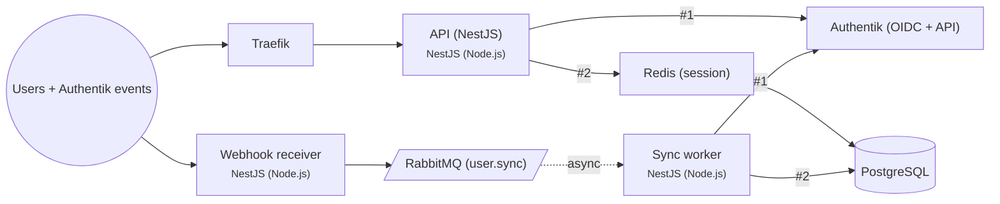

# Yêu cầu triển khai: Auth + đồng bộ user từ Authentik qua RabbitMQ

Bạn là kỹ sư backend/DevOps. Hãy triển khai hệ thống dưới đây đúng kiến trúc, công nghệ và chính sách gọi giữa các thành phần. Thiết kế đã được mô phỏng tải trong Pattern (discrete-event simulator); các con số là giả định và mục tiêu cần giữ. Nếu thấy điểm nào không hợp lý, hãy nêu rõ và đề xuất trước khi làm khác đi.

## 1. Mục tiêu và bối cảnh

Hai luồng dùng chung Authentik và PostgreSQL. Luồng đăng nhập: Traefik → API (① xác thực token với Authentik, ② đọc session/profile qua Redis, miss thì xuống PostgreSQL). Luồng sync: Authentik bắn webhook → receiver đẩy vào RabbitMQ rồi trả 200 ngay → worker gọi lại Authentik API lấy user rồi upsert PostgreSQL. Khi spike, worker sync gọi Authentik quá nhiều và làm chậm luồng đăng nhập. Ở giây 40, Authentik chậm ×4: backlog dồn trong RabbitMQ thay vì làm hỏng webhook.

## 2. Kiến trúc

| Thành phần | Công nghệ | Vai trò | Quy mô | Cấu hình then chốt |
|---|---|---|---|---|
| Users + Authentik events | Client | Nguồn traffic (người dùng / hệ thống bên ngoài) | — | — |
| Traefik | Traefik (`traefik:v3`) | Nhận traffic và chia đều cho các node phía sau | 1 instance × 20000 concurrency | entryPoints web/websecure; certificatesResolvers (ACME); middlewares: forwardAuth, retry, rateLimit |
| API (NestJS) | NestJS (Node.js) (`node:22-alpine`) | Service, gọi tuần tự các downstream | 2 instance × 100 concurrency | NODE_OPTIONS=--max-old-space-size; Prisma connection_limit; graceful shutdown (enableShutdownHooks) |
| Authentik (OIDC + API) | Authentik (`ghcr.io/goauthentik/server`) | Service xử lý request | 1 instance × 16 concurrency | AUTHENTIK_POSTGRESQL__*; AUTHENTIK_REDIS__HOST; số worker |
| Redis (session) | Redis (`redis:7-alpine`) | Cache, hit rate mục tiêu 90%; miss thì đọc xuống downstream | 1 instance × 5000 concurrency | hit rate 90%; maxmemory + maxmemory-policy allkeys-lru; appendonly yes (nếu cần bền); TTL cho mọi key cache |
| PostgreSQL | PostgreSQL (`postgres:17-alpine`) | Lưu trữ dữ liệu | 1 instance × 30 concurrency | tổng connection từ app ≈ 20 (max_connections phải lớn hơn); max_connections; shared_buffers ~25% RAM; PgBouncer pool_mode=transaction |
| Webhook receiver | NestJS (Node.js) (`node:22-alpine`) | Service | 1 instance × 200 concurrency | NODE_OPTIONS=--max-old-space-size; Prisma connection_limit; graceful shutdown (enableShutdownHooks) |
| RabbitMQ (user.sync) | RabbitMQ (`rabbitmq:4-management`) | Hàng đợi: ack ngay cho producer, consumer xử lý bất đồng bộ | 1 node, consumer concurrency 8 | consumer concurrency/prefetch tổng = 8; độ sâu tối đa 500,000; quorum queue; prefetch_count; dead-letter-exchange + x-delivery-limit |
| Sync worker | NestJS (Node.js) (`node:22-alpine`) | Service, gọi tuần tự các downstream | 2 instance × 4 concurrency | NODE_OPTIONS=--max-old-space-size; Prisma connection_limit; graceful shutdown (enableShutdownHooks) |

## 3. Luồng xử lý và chính sách gọi

- **Users + Authentik events** (Client) gửi request tới:
  - **Traefik** (Traefik): độ trễ mạng ~15ms
  - **Webhook receiver** (NestJS (Node.js)): độ trễ mạng ~2ms
- **Traefik** (Traefik) chia tải (round-robin) cho:
  - **API (NestJS)** (NestJS (Node.js)): độ trễ mạng ~1ms
- **API (NestJS)** (NestJS (Node.js)) gọi tuần tự (await lần lượt, cùng số thứ tự thì chạy song song):
  - 1. **Authentik (OIDC + API)** (Authentik): timeout 300ms, retry 1 lần (backoff 50ms, có jitter), circuit breaker (mở khi lỗi ≥ 50% trong 2s, tối thiểu 20 request; mở 5s)
  - 2. **Redis (session)** (Redis): mặc định (nên đặt timeout)
- **Redis (session)** (Redis) khi miss thì đọc:
  - **PostgreSQL** (PostgreSQL): connection pool 10/process (chờ tối đa 10s)
- **Webhook receiver** (NestJS (Node.js)) gọi:
  - **RabbitMQ (user.sync)** (RabbitMQ): timeout 200ms, publish có xác nhận (publisher confirm / acks)
- **RabbitMQ (user.sync)** (RabbitMQ) giao message bất đồng bộ cho consumer:
  - **Sync worker** (NestJS (Node.js)): consumer ack sau khi xử lý xong, tối đa 8 message đang xử lý cùng lúc (chia cho 2 instance)
- **Sync worker** (NestJS (Node.js)) gọi tuần tự (await lần lượt, cùng số thứ tự thì chạy song song):
  - 1. **Authentik (OIDC + API)** (Authentik): timeout 1s, retry 3 lần (backoff 200ms, có jitter), payload ~0KB → ~4KB
  - 2. **PostgreSQL** (PostgreSQL): connection pool 5/process (chờ tối đa 10s)

Với mỗi queue: consumer phải **idempotent** (at-least-once), có retry giới hạn và dead-letter queue cho message lỗi; producer chỉ trả lời sau khi broker xác nhận đã nhận message.

## 4. Yêu cầu phi chức năng

- **SLO**: p99 ≤ 300ms, tỉ lệ lỗi ≤ 1%; timeout phía client 1s.
- **Traffic**: 300 rps từ giây 0 → 900 rps từ giây 20 → 300 rps từ giây 30.
- **Phải chịu được các sự cố**:
  - giây 40: **Authentik (OIDC + API)** chậm ×4
  - giây 50: **Authentik (OIDC + API)** hoạt động trở lại
- **Chi phí ước tính** trong mô phỏng: ~1.28/giờ.

## 5. Kết quả mô phỏng gần nhất

Tại giây 5, 293 rps: p50 17.5ms, p99 124.8ms, lỗi 0%, đạt SLO 100% thời gian.

## 6. Sản phẩm bàn giao

- **Docker Compose** (`docker-compose.yml`): mọi thành phần self-host ở trên, healthcheck, volume cho dữ liệu, biến môi trường trong `.env.example`, giới hạn CPU/RAM gần với quy mô trong bảng.
- **Code NestJS** cho các service trong bảng: module rõ ràng, config qua `@nestjs/config`, client HTTP có timeout/retry/circuit breaker đúng mục 3, connection pool đúng kích thước, consumer queue idempotent, graceful shutdown, endpoint `/health`, log có correlation id.
- Script **k6** tái hiện profile traffic ở mục 4 và README hướng dẫn chạy local.

## 7. Tiêu chí chấp nhận

- Chạy k6 theo profile traffic: p99 ≤ 300ms, lỗi ≤ 1%.
- Timeout, retry, circuit breaker, pool đúng mục 3 (có test hoặc cấu hình kiểm chứng được).
- Tái hiện các sự cố ở mục 4 (tắt/làm chậm thành phần) mà hệ thống vẫn phục hồi, không mất dữ liệu.
- Gửi trùng một message hai lần không tạo dữ liệu trùng; message lỗi vào dead-letter queue.
- Mọi thành phần có healthcheck; khởi động bằng một lệnh.

---
_Sinh từ Pattern Studio · 13:57:12 17/11/2026_